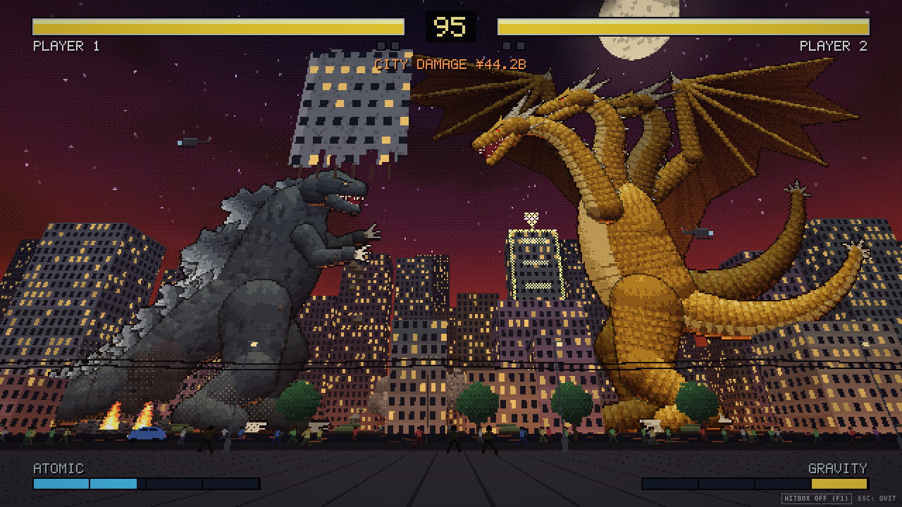

# KAIJU CLASH — Street Level

A pixel-art kaiju fighting game seen **from the street**. You are 1.7 m tall. They are 90–160 m tall.
Godzilla and King Ghidorah fight through a live city while the camera sits at human eye level, pitched
up into a burning sky — tiny people sprint past the lamp posts, power lines sag across the frame and
every building in the lane can be smashed or **ripped out of the ground and thrown**.



## Highlights

* **Every pixel drawn in code** — no spritesheets, no AI imagery. Each kaiju is a skeletal rig
  (spine/tail chain, IK legs, FK arms, hinged jaws, three independent necks for Ghidorah, membrane
  wings, dorsal plates) rasterised to pixel art at boot with an outline/shading pass, then uploaded
  once to a GPU **texture array**.
* **Street-level perspective** — a real 3D scene (perspective camera, depth buffer, alpha cut-out)
  rendered into a 640×360 framebuffer and upscaled with a sharp-bilinear pass. Facades, sky,
  smoke, beams and lightning are procedural shaders, so the whole game ships with ~400 kB of JS and
  no image downloads.
* **Visual hitboxes** — strike volumes are measured from the same joints the sprite is drawn from and
  baked per animation frame (`Frame.parts`). The simulation tests those boxes, so the hitbox *is* the
  visible limb (plus a 0.9 m forgiving skin). Press **F1** in-game to see the exact boxes.
* **Rollback netcode (GGPO-style)** over WebRTC data channels with UDP semantics, predicted inputs,
  redundant input packets, frame-advantage time sync, checksum desync detection and a server relay
  fallback when NAT traversal fails. Whole game state = one `Int32Array`, so a rollback is a single
  typed-array copy.
* **Deterministic 60 Hz simulation** — integer-only maths (centimetres), no `Math.sin` in gameplay
  code, fixed-point conversions. Verified headless at 0–150 ms latency with 20 % packet loss
  (`scripts/nettest.ts`): peers converge to a bit-identical state.
* **2.5D street** — the fight is no longer a single lane: X runs along the street, Z is depth.
  Walk into / out of the street with ↑ ↓, double-tap to **sidestep** (brief intangibility). Attacks
  only connect when both monsters share a lane (each move has its own depth reach; tail swings cover
  more), startups soft-home in depth, **beams sweep across lanes** toward the target (sidestep out of
  them), hurled towers fly in 3D and plough through anything in their path. A top-down **radar**
  shows lots, monsters and a green/red lane line. Fighters in different lanes can walk past each other.
* **Unlimited, destructible city** — 24 lots in three bands (front row, mid-street obstacles, back
  row). Every cleared lot is **rebuilt** (deterministically) ~7 s later: a new tower climbs out of
  scaffolding beside a tower crane. Per-hit damage, collapse debris, burning rubble, city-damage and
  rebuilt counters. Towers you can rip glow with a pulsing outline and rising chevrons.
* **Accurate tower ripping** — `↓+GRAB` locks a tower, the monster lunges so that its gripping hand
  (Godzilla) or near jaw (Ghidorah) meets the tower's near wall *exactly* at the grip frame (offsets
  measured from the baked rig, 0–5 cm error), crouches, tears it out of its foundations (soil and rebar
  raining off the base), heaves it and hoists it overhead. The tower is the real facade box pinned to
  the hand/jaw anchor of the very frame being drawn and rotated rigidly about the grip, so it never
  drifts off the hands. Then **carry** it (walk in any direction), **hurl** it (GRAB) or use it as a
  **club** (LIGHT/HEAVY) that shatters on the street and flattens neighbouring towers. Get hit while
  carrying and you drop it.
* **More moves & combos** — 3-hit LIGHT chain (claw → rising uppercut → lunging bite launcher),
  OTG stomp on a downed opponent, ROAR (meter + makes the army retreat), sidestep attacks, fixed
  tail sweep (↓+K) and shoulder charge (↑+K) which were unreachable before, combo rank callouts and
  best-combo tracking.
* **Human interactions** — civilians stroll the far bank and the near sidewalk, flee from nearby
  monsters, pour out of collapsing towers, get tossed by footsteps / slams / impacts, freeze when a
  monster roars and cheer the survivor. Soldiers hold the line by the tanks until a foot lands next to
  them. The **military** shells whichever monster has wrecked more of the city (helicopter missiles,
  tank fire, jet strafing runs — a little chip damage, a lot of rage meter); beams and flying towers
  swat helicopters out of the sky, reinforcements arrive later.

## v2 additions

* **Ghidorah** — both wings now sweep back from the same shoulder line (far wing behind the body, near wing in front);
  the near / far necks grow out of the chest (dithered root cross-fade into the torso) instead of ending in round caps.
* **Godzilla's tail** really whips: it coils behind, swings *under* the hips, crosses to the camera side
  (layer switch: the tail is drawn in front of the legs/arms) and cracks out across the front of the feet.
  HEAVY, TAIL SWEEP and TAIL SLAM all use the near-side tail.
* **Signature moves** per kaiju, with their own animation, hit volume, damage profile and sound:
  Godzilla — *ATOMIC PULSE* (nuclear ring, hits a huge volume, flings people and helicopters) and *MONSTER BODY SLAM*;
  Ghidorah — *TRI-HEAD FRENZY* (three heads bite in turn = three separate hits) and *WING GALE* (two wing beats, hurricane gust).
  New cancel routes (`CANCEL` in `sim.ts`) chain every earlier move into SIG1 → SIG2 → BEAM → SUPER.
* **Audio** — still 100 % synthesised (no samples, nothing to license): an original looping battle score
  ("Marching Ruin", 88 bpm, bass ostinato + timpani + brass clusters, intensity follows the fight), formant roars per monster,
  effort-roars on heavy / signature moves, tail-crack, gale, pulse, squash and helicopter-crush effects.
* **Street interactions** — GRAB with a helicopter in reach snatches it out of the sky and crushes it in the fist;
  footsteps, quake stomps, body slams and the pulse flatten the people underfoot.

## Controls

| Action | Solo / Online | Local P1 | Local P2 |
| --- | --- | --- | --- |
| Move / dash (double-tap) | A D or ← → | A D | ← → |
| Walk in depth / sidestep (double-tap) | W S or ↑ ↓ | W S | ↑ ↓ |
| Block | hold away | hold away | hold away |
| Light (×4 chain: CLAW › RISING CLAW › CROSS RAKE › LUNGE BITE) | J | F | J |
| Cyclone (after any of the string, B-button finisher) | K | G | K |
| Heavy (launcher / tail) | K | G | K |
| Low stomp (hits downed foes) | ↓ + J | S + F | ↓ + J |
| Tail sweep (knockdown) | ↓ + K | S + G | ↓ + K |
| Shoulder charge | ↑ + K | W + G | ↑ + K |
| Beam (1 bar) | L | H | L |
| Grab / throw | U | R | U |
| Rip tower → carry | ↓ + U | S + R | ↓ + U |
| Carrying: hurl / club smash | U / J·K | R / F·G | U / J·K |
| Roar (meter, army retreats) | ↑ + U | W + R | ↑ + U |
| **Signature 1** (Godzilla ATOMIC PULSE / Ghidorah TRI-HEAD FRENZY) | E or P | E | P |
| **Signature 2** (Godzilla MONSTER BODY SLAM / Ghidorah WING GALE) | C or N | C | N |
| Super (full meter) | I | T | I |
| Music on / off | M | M | M |
| Show hitboxes | F1 | F1 | F1 |

Gamepads: X light · Y heavy · B beam · A grab · RB super.

### Combo routes
* `LIGHT → LIGHT → LIGHT → HEAVY → CHARGE → BEAM → SUPER` (cancel on hit **or** block; a strict DAG, no infinite loops)
* `LIGHT → LOW → SWEEP → BEAM / SUPER`, then dash in for an OTG stomp
* launchers (LIGHT3, HEAVY, CHARGE, SWEEP) can be juggled by any hit until the juggle limit
* simultaneous active limbs **clash**: both fighters recoil, both build meter
* launch the opponent *through* a tower for bonus damage; the ground slam shatters nearby blocks
* if both players stall, the burning city "roars" and hands out meter to keep the match moving

## Stack

* Next.js (App Router, React 19) + Tailwind for the shell/menus
* WebGL2 renderer written from scratch (`src/game/render.ts`) — 4 batched draw streams +
  procedural shaders, GPU texture array for all sprite frames
* Deterministic simulation (`src/game/sim.ts`), pure animation mapping (`src/game/anim.ts`)
* Rollback session + WebRTC signalling (`src/game/net.ts`, `/api/rooms`, `/api/relay`)
* Drizzle ORM + PostgreSQL for rooms and the match/havoc leaderboard
* WebAudio synthesised SFX (`src/game/audio.ts`) — roars, stomps, beams, collapsing towers

## Run locally

```bash
npm install
cp .env.example .env          # point DATABASE_URL at a local PostgreSQL
npx drizzle-kit push          # create `rooms` + `matches`
npm run dev
```

Open the app, pick your kaiju, and fight. **VS CPU** and **LOCAL 2P** work offline; **CREATE ROOM**
gives you a 5-letter code for a friend (WebRTC P2P, automatic relay fallback).

### Dev tools

```bash
npx tsx scripts/nettest.ts          # hitbox reach table + rollback determinism at 0-150 ms / 20 % loss
npx tsx scripts/preview.ts godzilla 3 out.png idle:0 light:5 heavB:0
CROP=150,24,120,110 npx tsx scripts/preview.ts ghidorah 5 head.png idle:0   # zoom into the art
```

## v4 — music remix, 10x roars, long combo strings, wreckable city

* **Music** — a synthesised battle *remix* built on the 15-note Godzilla main-theme motif (C-B-A ×3, A-B-C, C-B-A — "Go-ji-ra"). 148 bpm, A minor,
  16-bar cycle: footstep intro → brass build → supersaw drop with pumping bass → fury (theme up a fourth) with snare rolls and risers.
  (The theme is © Toho / the Ifukube estate — this is a fan-game homage; swap `schedule()` in `audio.ts` before any commercial use.)
* **Roars (both kaiju)** — Godzilla: a bowed-double-bass roar (noise rubbed through a gliding resonating string) + formant voice + sub + scream, through
  distortion and a convolution hall, 3.6 s. Ghidorah: three warbling metallic heads in different registers over a lion-dragon body and gravity crackle.
  Shorter versions play as effort-roars on heavy / signature moves.
* **Combos (Brawlhalla-style)** — normals: `J J J J` CLAW › RISING CLAW › **CROSS RAKE / TWIN SNAP** › LUNGE BITE, then `K` = **TAIL / WING CYCLONE**.
  Signatures: `E`/`P` (SIG 1) › `E`/`P` again = **SIG 3 FINALE** (Godzilla ATOMIC RAMPAGE / Ghidorah KING'S WRATH, three blows, the last launches), or `C`/`N` (SIG 2) › any signature.
  Light links now push the foe less so the string actually connects; multi-hit moves can be cancelled after *any* connected hit. Slash sparks follow every live strike volume.
* **City** — towers have less HP, walking / dashing / carrying wrecks them faster, a falling tower topples into its neighbours (chain reactions), almost every tower can be
  ripped (up to 110 m), the rip window is much more forgiving, a plain GRAB rips a tower when the other kaiju is out of reach, rip / hurl / club are quicker and a carried tower lasts 10 s.
* **Helicopters** — 5 of them, swatted by any strike (claws, tails, wings, heads), a falling heli takes out others in mid-air and explodes in a shockwave; crushing one in your fist
  chains to its wingmen; the grab window is wider; reinforcements arrive faster.
* **Round timer ×5** — 8:15 (495 s) per round, shown as M:SS.

## v3 — slow "giant" timing, new moves, objectives, dual control

* **Human-scale timing** — every move is retimed from one table (`src/game/timing.ts`). The keyframed art *and* the sim frame
  data derive from it, so hitboxes still equal the drawn limbs. Wind-ups are ~2x slower (a 1.7 m human can actually read a
  120 m monster rearing back), strikes snap, recoveries are heavier, launches hang longer. A WIND-UP bar and the move name
  appear under each health bar.
* **Beams leave the real mouth** — each frame bakes the mouth anchor *and* the head axis (`Frame.mslope`). The renderer
  draws the ray from that anchor along that axis (Ghidorah: three rays, three axes) and the simulation tests the same ray
  against the victim's body / towers, burning into the street where it meets the ground. Energy visibly gathers in the
  mouth(s) during the charge. Hold DOWN / UP while firing to tilt the head (3 baked pitch variants).
* **New moves** — RISING JAW / MAWS (↑+LIGHT), TAIL SLAM / MACE SLAM (HEAVY, HEAVY), QUAKE STOMP (LIGHT after
  LOW / SWEEP / CHARGE / TAIL SLAM / RISING JAW; shockwave also crushes spotters). Cancel graph is still a strict DAG.
* **Wrecking** — ripping a tower now cracks the street, shudders it out of its foundations (soil, rebar, arcing mains),
  slabs and glass fall off it for the whole carry, and the lot keeps a broken stub with rebar in a crater.
* **Objectives & powers** — the city marks a condemned tower; wreck it first for meter, repairs and a power orb.
  Glowing power-core towers drop orbs too: RAGE, IRON HIDE, ATOMIC SURGE, REGEN.
* **Dual control (spotter)** — hold SPOTTER (Q / Shift, O / Space, pad LB) and directions + A/B drive a tiny human on the
  street while the kaiju keeps beam/grab/super. A plants a demolition charge (stand still, then run), B calls a missile strike.
  Feet, quakes and falling towers flatten him.

`npx tsx scripts/simtest.ts` — headless checks: every move connects, beam rays per pitch, spotter charge, deterministic CPU-vs-CPU.

## v4 — heavier kaiju, icon HUD, guided intro

* **Weight** — walking, dashing and attack lunges now accelerate and decelerate (`approach()` in `sim.ts`): kaiju take a few
  steps to get going, keep stepping while they slide to a stop, and carry momentum into strikes. Walk cycles are slower, dashes
  ease in/out, wind-ups are ~20 % longer again (`timing.ts`) and keyframes ease in/out (strikes accelerate *into* impact).
  There is deliberately no new meter for any of this — you read it from the body.
* **Godzilla K moves redrawn** (HEAVY, TAIL SWEEP `↓+K`, TAIL SLAM `K,K`) — the tail is now a lagged chain (`lagChain`):
  it hooks up behind the back, arcs over, cracks forward and recoils over the spine instead of rotating as a rigid rod through
  the torso. Limb roots are cross-faded into the body (`rootBlend`, `flush(..., inner)`), so hips / shoulders no longer have a
  hard outline seam where they meet the torso. The sim still tests the drawn tail volume; reach was re-measured per frame.
* **HUD is icons, not sentences** — move names, wind-up bars, objective text, city-damage and army banners are gone. Status is
  shown with pixel icons (`src/game/hud.ts`): power-ups drain as icon + bar, spotter state is an icon, objectives are one chip
  with a draining bar plus an edge arrow when the marked tower is off-screen, the army is a flashing star over the target.
* **Guided intro (VS CPU / online)** — one control at a time as an icon + animated keycap, waiting until you actually do it
  (walk → claw → tail → street → rip → beam), with a step pip row. Progress is remembered; *REPLAY TUTORIAL* is in the menu.
  First objective now arrives after ~25 s (`OBJ_FIRST`), with longer gaps.
